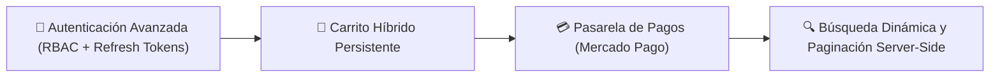
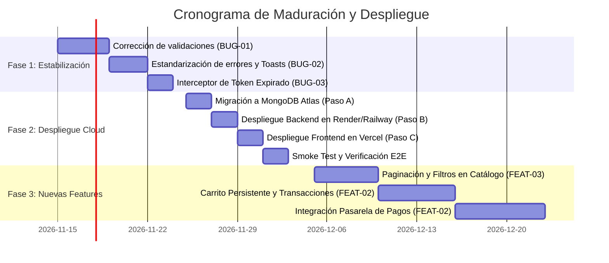

# 📋 Bug Tracker, Mejoras y Backlog de Pendientes
**Proyecto:** M&L Beauty E-commerce  
**Stack Tecnológico:** Node.js, Express, MongoDB (Mongoose), React (Vite), Supabase Storage, Multer, Bootstrap & CSS Personalizado.  
**Versión Actual:** MVP v1.0 (Entregado / Funcional Local)  
**Fecha de Elaboración:** Noviembre 2026  
**Audiencia:** Equipo de Desarrollo, Evaluadores Académicos y Stakeholders  

---

## 🎯 Resumen Ejecutivo

El presente documento consolida el estado técnico del sistema **M&L Beauty E-commerce** tras la consolidación exitosa de su MVP (Catálogo de productos, subida multipart/form-data con almacenamiento dinámico en Supabase Storage, autenticación JWT y panel administrativo).

El objetivo es establecer un plan riguroso de maduración del software dividiendo el trabajo en cuatro frentes estratégicos:
1. **Bug Fixing:** Corrección de defectos y blindaje de validaciones.
2. **Refactoring & Code Quality:** Optimización de rendimiento, imágenes y cobertura de testing.
3. **Product Backlog:** Incorporación de funcionalidades comerciales de alto impacto.
4. **Deployment Roadmap:** Plan paso a paso para el despliegue del stack completo en la nube (MongoDB Atlas + Render/Railway + Vercel).

---

## 1. 🐛 BUGS Y DEFECTOS CONOCIDOS A CORREGIR (Bug Fixing)

### Matriz de Incidencias

| ID | Módulo | Defecto | Severidad | Prioridad | Estado |
| :--- | :--- | :--- | :--- | :--- | :--- |
| **BUG-01** | Frontend / Backend | Validaciones débiles de tipos y valores extremos en formularios | Media | **ALTA** | Identificado |
| **BUG-02** | Frontend / UI | Manejo heterogéneo de errores HTTP y notificaciones visuales | Media | **ALTA** | Identificado |
| **BUG-03** | Auth / Sesión | Desincronización de token JWT expirado sin redirección automática | Media | **MEDIA** | Identificado |
| **BUG-04** | Formulario Admin | Reset manual incompleto en preview de imágenes al cancelar edición | Baja | **BAJA** | Identificado |

---

### Detalle de Incidencias y Plan de Acción

#### 🔴 BUG-01: Validaciones de formularios en Frontend y Backend (Manejo de Strings vs. Tipos Nativos)
* **Descripción:** Al utilizar formularios con carga de archivos (`multipart/form-data` con Multer), todos los campos del cuerpo (`req.body`) viajan inicialmente como cadenas de texto (`strings`). Aunque Mongoose realiza un casteo automático, campos numéricos con valores vacíos (`""`), ceros accidentales o caracteres especiales pueden desencadenar errores de validación internos o estados inconsistentes de inventario. En el frontend, algunos campos numéricos carecen de validación en tiempo real para evitar números negativos o decimales en el stock.
* **Causa Raíz:** Ausencia de una capa intermedia de parseo/validación de esquema estricto (schema validation) antes de que los datos alcancen la capa de persistencia en Mongoose.
* **Acciones Correctivas:**
  1. **Backend:** Implementar middleware de validación con librerías como **Zod** o **Joi** para sanear y tipar datos antes de entrar a los controladores.
  2. **Backend:** Garantizar valores por defecto y conversiones explícitas (`Number()`, `Boolean()`) como ya se introdujo en el servicio de productos.
  3. **Frontend:** Agregar validadores HTML5 (`min="0"`, `step="1"`) y validación programática en los hooks `onChange` con mensajes inline para el usuario antes del `submit`.

#### 🔴 BUG-02: Control de errores en peticiones HTTP y feedback visual al usuario final
* **Descripción:** Si bien el backend responde con códigos de estado HTTP (400, 401, 403, 404, 500), la estructura del payload de error aún presenta variaciones en algunos endpoints (en ocasiones `{ error }`, `{ message }` o `{ mensajeError, detalles }`). En el frontend, ciertas acciones críticas todavía utilizan `window.alert()` o no muestran mensajes descriptivos si la API rechaza la conexión por caída de red.
* **Causa Raíz:** Falta de un formato canónico de error (API Error Contract) y de un despachador unificado de alertas en todos los componentes.
* **Acciones Correctivas:**
  1. **Backend:** Estandarizar un middleware global de errores que devuelva siempre el formato:
     ```json
     {
       "success": false,
       "error": {
         "code": "VALIDATION_ERROR",
         "message": "Descripción legible para el usuario",
         "details": []
       }
     }
     ```
  2. **Frontend:** Centralizar la presentación de estados mediante un contexto global de notificaciones (`ToastContext`) para emitir alertas de éxito, advertencia y error de forma no intrusiva y accesible.

#### 🟡 BUG-03: Desincronización de sesión por Token JWT expirado
* **Descripción:** Cuando el token de 2 horas expira, cualquier petición administrativa o protegida devuelve un código HTTP 401. El cliente no siempre intercepta este código inmediatamente, lo que puede provocar que el usuario permanezca en una vista administrativa con tablas vacías en lugar de ser redirigido al login.
* **Causa Raíz:** Los hooks de petición realizan `fetch` sin un wrapper centralizado de interceptor de respuestas HTTP.
* **Acciones Correctivas:**
  1. Crear una función utilitaria `apiClient(url, options)` en el frontend que inspeccione cada respuesta.
  2. Ante un status `401 Unauthorized`, remover automáticamente `token` y `user` de `sessionStorage`/`localStorage` y ejecutar `window.location.href = '/login?expired=true'`.

---

## 2. ⚙️ COSAS A MEJORAR Y OPTIMIZACIONES (Refactoring & Code Quality)

### 🟡 OPT-01: Limpieza de código y estandarización de controladores (Clean Controller Pattern)
* **Prioridad:** **ALTA**
* **Objetivo:** Asegurar que los controladores actúen únicamente como orquestadores HTTP, delegando toda regla de negocio a la capa de servicios (`services/`).
* **Propuestas de mejora:**
  * Implementar una clase utilitaria `ApiResponse` para estandarizar las respuestas exitosas:
    ```javascript
    // Ejemplo de formato unificado
    return ApiResponse.success(res, { data: products, total: products.length }, 200);
    ```
  * Eliminar llamadas residuales a `console.log()` en código de producción e integrar un logger estructurado como **Winston** o **Morgan** para registrar peticiones entrantes con fecha, método, código de respuesta y tiempo de ejecución.

### 🟡 OPT-02: Optimización de carga de imágenes y caché en Supabase Storage
* **Prioridad:** **MEDIA**
* **Objetivo:** Mejorar los tiempos de carga en el catálogo de productos y minimizar el consumo de cuota de transferencia.
* **Propuestas de mejora:**
  1. **Compresión previa en servidor (Sharp):** Incorporar la librería `sharp` como middleware en Node.js para redimensionar imágenes a un máximo estándar (ej. 1000x1000 px) y convertirlas a formato `.webp` con compresión de calidad 80% antes de enviarlas al bucket de Supabase.
  2. **Cabeceras de caché:** Configurar la propiedad `cacheControl: '3600'` (o superior) en el método `bucket().upload(...)` para que los navegadores almacenen en caché las imágenes públicas.
  3. **Frontend Lazy Loading:** Incorporar el atributo nativo `loading="lazy"` y placeholders en todas las etiquetas `` de las cards de productos para mejorar el puntaje de *Core Web Vitals* (LCP y CLS).

### 🟡 OPT-03: Implementación de Suite de Pruebas Automatizadas (Unit & Integration Testing)
* **Prioridad:** **ALTA / MEDIA**
* **Objetivo:** Brindar cobertura de código para evitar regresiones lógicas ante nuevos cambios.
* **Plan de Testing:**
  * **Backend (Vitest / Jest + Supertest + MongoMemoryServer):**
    * **Auth Suite:** Registro de usuarios, hashing de contraseñas, login con credenciales válidas e inválidas, verificación de expiración de token.
    * **Products Suite:** Creación de producto con validación de categorías (1 al 5), asignación condicional de material (yeso/cemento para categoría 5), protección de endpoints sin token staff.
    * **Orders Suite:** Cálculo de subtotal, verificación de stock disponible y transición de estados (`pending` -> `confirmed` -> `shipped` -> `completed`).
  * **Frontend (React Testing Library + Vitest):**
    * Renderizado correcto de catálogos y filtrado por categoría.
    * Validación de inputs en el modal `ProductFormModal`.

---

## 3. 🚀 NUEVAS FUNCIONALIDADES A AGREGAR (Product Backlog / Features Futuras)



### 🔷 FEAT-01: Flujo Completo de Autenticación, Roles y Recuperación de Contraseña
* **Prioridad:** **ALTA**
* **Alcance:**
  * **Refresh Tokens seguros:** Migrar el almacenamiento de tokens de sesión a cookies `HttpOnly` y `Secure`, reduciendo la superficie de ataque ante vectores XSS.
  * **Recuperación de credenciales:** Flujo de "Olvidé mi contraseña" mediante envío de emails transaccionales con tokens de un solo uso válidos por 15 minutos (utilizando **Nodemailer** o **Resend**).
  * **Panel de Perfil de Usuario:** Vista para que el cliente consulte sus pedidos anteriores, actualice sus datos de envío y modifique su clave.
  * **Control de Acceso Basado en Roles (RBAC) granular:** Distinción formal entre `customer` (comprador), `employee` (gestor de stock) y `superadmin` (control total y cambio de roles).

### 🔷 FEAT-02: Carrito Persistente y Pasarela de Pago Integrada
* **Prioridad:** **ALTA**
* **Alcance:**
  * **Sincronización Híbrida del Carrito:** Carrito reactivo almacenado en `localStorage` para usuarios invitados, el cual se sincroniza automáticamente con la base de datos de MongoDB en el momento en que el usuario inicia sesión.
  * **Transacciones Atómicas de Stock:** Utilizar sesiones de Mongoose (`mongoose.startSession()`) para garantizar que el descuento de stock de múltiples productos durante el checkout sea atómico (si un producto se agota en el proceso, la transacción se revierte por completo).
  * **Integración con Mercado Pago SDK:** Generación de preferencias de pago con **Checkout Pro** y recepción de webhooks en `/api/payments/webhook` para actualizar el estado del pedido automáticamente a `confirmed` una vez acreditado el dinero.
  * **Notificaciones por Email:** Disparo automático de resumen de compra con plantilla HTML al comprador y alerta de nuevo pedido al administrador.

### 🔷 FEAT-03: Búsqueda Avanzada, Filtros Combinados y Paginación Server-Side
* **Prioridad:** **MEDIA**
* **Alcance:**
  * **Búsqueda por texto con Debounce:** Input de búsqueda en la cabecera que busque coincidencias por nombre o descripción con un retraso controlado de 300ms para evitar sobrecarga de peticiones.
  * **Filtros combinados:** Selección simultánea de categoría, rango de precio (control slider mínimo y máximo), disponibilidad de stock y material.
  * **Paginación en Backend:** Modificar el endpoint `GET /api/products` para aceptar parámetros `page` y `limit`, aplicando `.skip()` y `.limit()` en Mongoose y devolviendo metadatos de paginación (`totalPages`, `totalItems`, `currentPage`).

---

## 4. 🌐 PLAN DE DESPLIEGUE A PRODUCCIÓN (Deployment Roadmap)

Para llevar el proyecto de un entorno local a un entorno productivo accesible en internet de forma segura y escalable, se establece la siguiente ruta de 3 fases:

```
[ MongoDB Atlas (DB Cloud) ]  <---  [ Render / Railway (Backend API) ]  <---  [ Vercel (Frontend SPA) ]
```

---

### 📦 Paso A: Migración de Base de Datos a MongoDB Atlas

1. **Creación de Cluster:**
   * Crear una cuenta en [MongoDB Cloud Atlas](https://www.mongodb.com/cloud/atlas).
   * Desplegar un cluster compartido gratuito **M0 (Shared)** en la región más cercana (ej. AWS `sa-east-1` São Paulo o `us-east-1` N. Virginia).
2. **Configuración de Seguridad de Red (Network Access):**
   * En la sección **Network Access**, agregar la regla de IP: `0.0.0.0/0` (*Allow Access from Anywhere*). Esto es indispensable para que servicios serverless o plataformas de nube con IPs dinámicas (como Render o Vercel) puedan conectarse sin bloqueos.
3. **Creación de Credenciales de Acceso (Database Access):**
   * Crear un usuario administrador (ej. `admin_m&l`) con contraseña segura y rol `readWriteAnyDatabase`.
4. **Obtención del Connection String:**
   * En el botón **Connect**, seleccionar *Drivers (Node.js)* y copiar la URI:
     ```text
     mongodb+srv://admin_ml:<PASSWORD>@cluster0.xxxxx.mongodb.net/ML_Beauty?retryWrites=true&w=majority
     ```
5. **Migración de Datos Iniciales (Seeding):**
   * Ejecutar la migración de colecciones (usuarios iniciales y categorías de productos) apuntando temporalmente el `MONGO_URI` local hacia la cadena de Atlas mediante un script de seed o `mongorestore`.

---

### 🚀 Paso B: Despliegue del Backend en Render / Railway

1. **Repositorio:** Subir los últimos cambios del proyecto a GitHub en una rama principal (`main` o `master`).
2. **Creación del Servicio Web (Web Service en Render o Railway):**
   * Conectar la cuenta de GitHub y seleccionar el repositorio.
   * **Root Directory:** `MiPaginaUtn/Proyecto-MiPagina/backend`
   * **Environment:** `Node`
   * **Build Command:** `npm install`
   * **Start Command:** `npm start` (o `node src/server.js`)
3. **Configuración de Variables de Entorno en el Dashboard Cloud:**
   Configurar las siguientes claves en la sección *Environment Variables*:
   * `NODE_ENV` = `production`
   * `PORT` = `10000` (o el puerto provisto por la plataforma)
   * `MONGO_URI` = `mongodb+srv://admin_ml:<PASSWORD>@cluster0.xxxxx.mongodb.net/ML_Beauty?retryWrites=true&w=majority`
   * `JWT_SECRET` = `<CLAVE_SECRETA_CRIPTOGRAFICA_DE_PRODUCCION>`
   * `JWT_EXPIRATION` = `2h`
   * `STORAGE` = `supabase`
   * `SUPABASE_URL` = `https://flqddoznzbtltfgrzumz.supabase.co`
   * `SUPABASE_KEY` = `<SERVICE_ROLE_SECRET_KEY_DE_SUPABASE>` *(Recomendada para producción para bypass de RLS seguro desde el servidor)*
   * `CARPETA_IMAGENES` = `CARPETA_IMAGENES`
   * `CORS_ORIGIN` = `https://tu-tienda-m-and-l.vercel.app` *(o `*` durante las primeras pruebas)*
4. **Verificación de Salud:** Comprobar que el servicio quede en estado `Live` y que responda exitosamente a la ruta base de verificación.

---

### ⚡ Paso C: Despliegue del Frontend (React/Vite) en Vercel

1. **Importación del Proyecto en Vercel:**
   * Iniciar sesión en [Vercel](https://vercel.com/) con la cuenta de GitHub.
   * Seleccionar **Add New Project** e importar el repositorio.
2. **Ajuste de Directorios y Build:**
   * **Root Directory:** `MiPaginaUtn/Proyecto-MiPagina`
   * **Framework Preset:** `Vite`
   * **Build Command:** `npm run build`
   * **Output Directory:** `dist`
3. **Variables de Entorno en Vercel:**
   * Agregar la variable que consumen los hooks de React:
     * `VITE_API_URL` = `https://tu-backend.onrender.com/api` (URL pública provista por Render en el Paso B).
4. **Soporte para Rutas SPA (HTML5 History API):**
   * Para evitar errores 404 al recargar páginas internas (como `/admin/products`, `/products` o `/cart`), verificar o incluir el archivo `vercel.json` en la raíz del frontend:
     ```json
     {
       "rewrites": [
         { "source": "/(.*)", "destination": "/index.html" }
       ]
     }
     ```
5. **Prueba Integral de Punta a Punta (E2E Smoke Test):**
   * Ingreso a la URL pública de Vercel (HTTPS automático).
   * Login con usuario de pruebas administrador (`mora@test.com`).
   * Creación de un nuevo producto con imagen adjunta: verificar que la imagen persista en Supabase Storage y el registro en MongoDB Atlas.
   * Cierre de sesión y prueba de navegación de cliente invitado.

---

## 5. 📅 CRONOGRAMA DE EJECUCIÓN PROPUESTO



---
*Documentación técnica generada como anexo del proyecto M&L Beauty E-commerce.*

