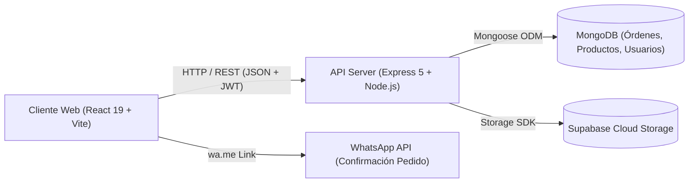

# 🌸 M&L Beauty - Plataforma E-commerce Full-Stack


Bienvenido a la documentación oficial de **M&L Beauty**, una solución integral de comercio electrónico de arquitectura **Full-Stack**. La plataforma está orientada a la comercialización de productos de belleza, perfumería, bijouterie/accesorios, velas aromáticas de cera de soja y figuras decorativas artesanales.

El ecosistema integra una interfaz web reactiva (**React 19 + Vite**) con un servidor RESTful desacoplado (**Node.js + Express**) respaldado por una base de datos documental (**MongoDB + Mongoose**), almacenamiento en la nube (**Supabase**) y autenticación sin estado mediante **JSON Web Tokens (JWT)**.

---

## 🔑 Credenciales de Prueba para Evaluación

Para facilitar la revisión integral de las funcionalidades y niveles de autorización por roles (RBAC), utilice las siguientes cuentas preconfiguradas:

| Rol | Correo Electrónico | Contraseña | Permisos y Alcance |
| :--- | :--- | :--- | :--- |
| **👑 Administrador** | `mora@test.com` | `password123` | Control total del sistema: Gestión de catálogo (creación, edición, baja), panel de órdenes (`/admin/orders`) con cambio de estados y panel de usuarios (`/admin/users`) con asignación de roles. |
| **🛍️ Comprador (Cliente)** | `juanpascal@gmail.com` | `juan5678` | Navegación de catálogo, carrito persistido en MongoDB (orden `draft`), checkout adaptativo con selección de entrega y confirmación de pedidos vía WhatsApp. |

> [!TIP]
> **Modo Demo Rápido**: En caso de acceder sin iniciar sesión a una ruta administrativa, el componente `AdminRoute` también incluye un botón de simulación para agilizar la prueba en entornos locales.

---

## 🚀 Guía de Inicio Rápido

Para poner en funcionamiento el sistema de punta a punta, inicie tanto el servidor backend como la aplicación frontend.

### 1. Requisitos Previos
* **Node.js** v18 o superior instalado en el equipo.
* **MongoDB** (instancia local en ejecución en `mongodb://localhost:27017` o una URI de MongoDB Atlas).

---

### 2. Puesta en Marcha del Backend (API REST)

```bash
# 1. Navegar al directorio del backend
cd Proyecto-MiPagina/backend

# 2. Instalar dependencias del servidor
npm install

# 3. Configurar variables de entorno (crear archivo .env)
# Si no existe, crear .env con:
# PORT=3000
# MONGO_URI=mongodb://localhost:27017/M&L
# JWT_SECRET=mi_secreto_super_seguro_jwt
# JWT_EXPIRATION=2h
# STORAGE=supabase  # o "local"
# SUPABASE_URL=https://tu-proyecto.supabase.co
# SUPABASE_KEY=tu-clave-anon-supabase

# 4. (Opcional) Poblar base de datos con datos semilla iniciales
npm run seed

# 5. Iniciar servidor en modo desarrollo
npm run dev
```

* El servidor API se levantará en: **`http://localhost:3000`**
* Documentación interactiva Swagger UI disponible en: **`http://localhost:3000/api-docs`**

---

### 3. Puesta en Marcha del Frontend (React Client)

```bash
# 1. Navegar a la carpeta raíz del frontend
cd Proyecto-MiPagina

# 2. Instalar dependencias cliente
npm install

# 3. Iniciar el servidor de desarrollo Vite
npm run dev
```

* La aplicación web estará accesible inmediatamente en: **`http://localhost:5173`**

---

## 🛠️ Arquitectura y Stack Tecnológico



### 1. Frontend
* **React 19**: Construcción declarativa basada en componentes y custom hooks reutilizables.
* **React Router DOM v7**: Ruteo desacoplado del lado del cliente (SPA), carga perezosa y rutas con control de acceso (`ProtectedRoute`, `AdminRoute`).
* **React Bootstrap & Bootstrap 5**: Utilizado estratégicamente para modales, menús de navegación administrativa y controles accesibles.
* **Vanilla CSS Modular**: Sistema de diseño con identidad propia respetando la paleta de la marca (`#b79067`, `#464d5d`, etc.), sin frameworks invasivos.
* **Context API**:
  * `AuthContext`: Gestión de credenciales, decodificación de rol, persistencia en `sessionStorage` / `localStorage` y helpers de sesión.
  * `CartContext`: Sincronización en tiempo real del carrito con el borrador persistente en MongoDB.

### 2. Backend
* **Node.js & Express 5**: Servidor HTTP modular con controladores, servicios y middlewares de autorización.
* **MongoDB & Mongoose 9**: Modelado de datos estructurado con validadores a nivel de esquema, referencias pobladas (`.populate`) y subdocumentos embebidos.
* **Bcrypt / Bcryptjs**: Algoritmo seguro de hashing de contraseñas con salting (10 vueltas) en hooks `pre('save')`.
* **JSON Web Tokens (JWT)**: Autenticación por token Bearer sin estado para validar la identidad y el rol en cada petición.
* **Supabase Storage**: Subida y entrega de imágenes de catálogo en bucket CDN de alta velocidad, con fallback automático a almacenamiento local mediante Multer.
* **Manejo Centralizado de Errores**: Middleware `manejarErrores` que captura instancias de `ErrorApp`, validaciones Mongoose y códigos de duplicidad (11000).

---

## 🗂️ Estructura del Proyecto

```text
Proyecto-MiPagina/
├── backend/                       # Servidor Node.js + Express
│   ├── src/
│   │   ├── config/                # Clientes externos (Supabase, etc.)
│   │   ├── controllers/           # Controladores de petición/respuesta HTTP
│   │   │   ├── authController.js
│   │   │   ├── orderController.js
│   │   │   ├── productController.js
│   │   │   └── userController.js
│   │   ├── docs/                  # Configuración Swagger OpenAPI 3.0
│   │   ├── middleware/            # Middlewares (verificarToken, permitirRoles, multer)
│   │   ├── models/                # Esquemas Mongoose (User, Product, Order)
│   │   ├── routes/                # Rutas Express (/auth, /products, /orders, /users)
│   │   ├── services/              # Lógica de negocio y consultas a base de datos
│   │   ├── utils/                 # Constantes, configuración de .env y ErrorApp
│   │   ├── app.js                 # Inicialización y middlewares globales de Express
│   │   ├── db.js                  # Conector de base de datos MongoDB
│   │   ├── index.js               # Punto de entrada y listener del servidor
│   │   └── seed.js                # Poblado de prueba de la base de datos
│   └── package.json
│
├── src/                           # Aplicación Cliente React (Frontend)
│   ├── assets/                    # Recursos gráficos y multimedia
│   ├── components/                # Componentes reutilizables
│   │   ├── Admin/                 # Componentes del panel administrativo
│   │   │   ├── AdminNavTabs.jsx   # Barra unificada de pestañas (Productos, Órdenes, Usuarios)
│   │   │   ├── AdminRoute.jsx     # HOC protector de rutas exclusivas de admin
│   │   │   ├── Orders/            # Tabla y modal de detalle de órdenes
│   │   │   ├── Products/          # Tabla, formularios y modales de productos
│   │   │   └── Users/             # Tabla de gestión de usuarios y roles
│   │   ├── Layout/                # Estructura general (Header, Footer, Menú, ProtectedRoute)
│   │   └── cards/                 # Tarjetas de catálogo, modales y toast notifications
│   ├── context/                   # Proveedores de estado global (AuthContext, CartContext)
│   ├── hooks/                     # Custom hooks desacoplados por entidad
│   │   ├── admin/                 # useAdminProducts, useAdminOrders, useAdminUsers
│   │   ├── orders/                # useCart, useOrders
│   │   ├── products/              # useGetProduct, useGetProductByCategory, etc.
│   │   └── user/                  # useAuth, useLoginUser, useRegisterUser
│   ├── pages/                     # Vistas principales de navegación
│   │   ├── Admin/                 # ProductManagementPage, OrderManagementPage, UserManagementPage
│   │   ├── Cart/                  # CartPage, CheckoutWhatsApp
│   │   ├── CRUD/                  # CreateProductPage, EditProductPage
│   │   ├── Login-Registro/        # Login, Register
│   │   └── MenuPage/              # Accesorios, Velas, Perfumes, CuidadosDiarios, etc.
│   ├── utils/                     # Conector HTTP api.js, adapters y formateo WhatsApp
│   ├── router.jsx                 # Configuración del árbol de rutas React Router
│   └── App.jsx
└── package.json
```

---

## 📚 Listado Detallado de Endpoints de la API

La API responde sobre el prefijo `/api` (manteniendo alias compatibles directos). A continuación se documentan todos los endpoints agrupados funcionalmente.

---

### 1. Autenticación (`/api/auth`)

#### `POST /api/auth/registro`
Registra un nuevo usuario en la plataforma con contraseña encriptada con Bcrypt.

* **Headers**: `Content-Type: application/json`
* **Body Request**:
```json
{
  "name": "Juan",
  "lastname": "Pascal",
  "date": "1995-04-12",
  "email": "juanpascal@gmail.com",
  "password": "password123"
}
```
* **Respuesta Exitosa (201 Created)**:
```json
{
  "usuario": {
    "id": "672f0a1b9c3e2a0012345678",
    "name": "Juan",
    "lastName": "Pascal",
    "email": "juanpascal@gmail.com",
    "role": "comprador"
  },
  "token": "eyJhbGciOiJIUzI1NiIsInR5cCI6IkpXVCJ9.eyJpZCI6IjY3MmYwYTFiOWMzZTJhMDAxMjM0NTY3OCIsInJvbGUiOiJjb21wcmFkb3IiLCJpYXQiOjE3MzExODk2MDB9..."
}
```

#### `POST /api/auth/login`
Inicia sesión y genera un JWT firmado con expiración configurada.

* **Body Request**:
```json
{
  "email": "mora@test.com",
  "password": "password123"
}
```
* **Respuesta Exitosa (200 OK)**:
```json
{
  "usuario": {
    "id": "672f0b999c3e2a0012345679",
    "name": "Mora",
    "lastName": "Gutierrez",
    "email": "mora@test.com",
    "role": "admin"
  },
  "token": "eyJhbGciOiJIUzI1NiIsInR5cCI6IkpXVCJ9.eyJpZCI6IjY3MmYwYjk5OWMzZTJhMDAxMjM0NTY3OSIsInJvbGUiOiJhZG1pbiIsImlhdCI6MTczMTE4OTYwMH0..."
}
```

#### `GET /api/auth/perfil`
Devuelve el perfil del usuario autenticado.
* **Headers**: `Authorization: Bearer <token>`
* **Respuesta Exitosa (200 OK)**: Devuelve la entidad de usuario (excluyendo el campo `password`).

---

### 2. Catálogo y Productos (`/api/products`)

> [!NOTE]
> **Identificadores de Categorías**:
> `1`: Perfumes | `2`: Accesorios | `3`: Velas | `4`: Cuidados Diarios | `5`: Figuras de Yeso y Cemento.

#### `GET /api/products`
Obtiene la lista completa de productos disponibles con soporte para filtros por query param (`?category_id=3`, `?active=true`, `?highlighted=true`).

* **Respuesta Exitosa (200 OK)**:
```json
[
  {
    "_id": "6724fa10b91e12a456123401",
    "name": "Vela Aromática en Frasco de Vidrio (Vainilla & Coco)",
    "price": 9500,
    "description": "Vela artesanal de cera de soja con pabilo de madera de encendido prolongado.",
    "quantity": 12,
    "active": true,
    "highlighted": true,
    "category_id": 3,
    "image": "https://flqddoznzbtltfgrzumz.supabase.co/storage/v1/object/public/products/vela-soja.jpg",
    "material": null,
    "createdAt": "2026-11-01T14:30:00.000Z"
  }
]
```

#### `GET /api/products/:id`
Obtiene los detalles específicos de un producto por su `_id` de MongoDB.

#### `POST /api/products` (Requiere rol Admin o Vendedor)
Crea un nuevo producto en catálogo con soporte para subida de imagen a Supabase Storage vía `multipart/form-data`.

* **Headers**: `Authorization: Bearer <token>`
* **Form-Data**:
  * `name`: Busto Escultura David en Yeso
  * `price`: 8900
  * `description`: Figura decorativa en yeso sellado acabado matte.
  * `quantity`: 10
  * `category_id`: 5
  * `material`: yeso
  * `imagen`: [Archivo binario .jpg/.png]
* **Respuesta Exitosa (201 Created)**: Objeto producto creado con su URL de imagen persistida.

#### `PATCH /api/products/:id` (Requiere Admin)
Modificación parcial de campos o actualización de stock de un producto.

#### `DELETE /api/products/:id` (Requiere Admin)
Baja lógica o descontinuación del producto (`active: false`).

---

### 3. Carrito de Compras Persistente (`/api/orders`)

El sistema implementa el patrón **Active Draft Order**: el carrito activo del comprador se almacena de forma persistente en MongoDB con `status: "draft"`.

#### `GET /api/orders/cart`
Devuelve el carrito borrador activo del usuario conectado, poblando las referencias con `.populate("items.product_id")`.

* **Headers**: `Authorization: Bearer <token>`
* **Respuesta Exitosa (200 OK)**:
```json
{
  "_id": "672e819b4f910a3456789012",
  "user_id": "672f0a1b9c3e2a0012345678",
  "status": "draft",
  "delivery_method": "domicilio",
  "total_amount": 28000,
  "items": [
    {
      "product_id": {
        "_id": "6724fa10b91e12a456123401",
        "name": "Natura Ekos Body Splash Maracuyá",
        "price": 18500,
        "quantity": 15,
        "active": true
      },
      "product_name": "Natura Ekos Body Splash Maracuyá",
      "unit_price": 18500,
      "quantity": 1
    },
    {
      "product_id": {
        "_id": "6724fa10b91e12a456123402",
        "name": "Vela Aromática en Frasco de Vidrio",
        "price": 9500,
        "quantity": 8,
        "active": true
      },
      "product_name": "Vela Aromática en Frasco de Vidrio",
      "unit_price": 9500,
      "quantity": 1
    }
  ],
  "shipping": null
}
```

#### `POST /api/orders/items`
Agrega o incrementa un artículo dentro del carrito en MongoDB.

* **Headers**: `Authorization: Bearer <token>`, `Content-Type: application/json`
* **Body Request**:
```json
{
  "productId": "6724fa10b91e12a456123401",
  "quantity": 2
}
```
* **Respuesta Exitosa (200 OK)**: Carrito borrador actualizado con recalculo seguro de totales.

#### `DELETE /api/orders/items/:productId`
Quita un producto específico del carrito activo.

---

### 4. Checkout y Finalización de Compra (`/api/orders/checkout`)

#### `POST /api/orders/checkout`
Procesa la compra en una operación atómica: valida la disponibilidad de existencias, reduce el stock físico de cada producto (con rollback ante inconsistencias), genera un código de orden formal (`ORD-timestamp-rnd`), asigna los datos de envío y transiciona el estado de `"draft"` a `"pending"`.

* **Headers**: `Authorization: Bearer <token>`, `Content-Type: application/json`
* **Body Request**:
```json
{
  "shippingData": {
    "deliveryMethod": "domicilio",
    "street": "Calle 61 Nº 2450",
    "city": "Necochea",
    "zip_code": "7630",
    "paymentMethod": "transferencia",
    "phone": "2262123456",
    "notes": "Tocar timbre departamento 2B"
  }
}
```
* **Respuesta Exitosa (201 Created)**:
```json
{
  "_id": "672e819b4f910a3456789012",
  "order_number": "ORD-1731189950000-428",
  "user_id": "672f0a1b9c3e2a0012345678",
  "status": "pending",
  "delivery_method": "domicilio",
  "total_amount": 28000,
  "items": [
    {
      "product_id": "6724fa10b91e12a456123401",
      "product_name": "Natura Ekos Body Splash Maracuyá",
      "unit_price": 18500,
      "quantity": 1
    }
  ],
  "shipping": {
    "street": "Calle 61 Nº 2450",
    "city": "Necochea",
    "zip_code": "7630"
  },
  "created_at": "2026-11-09T20:45:00.000Z"
}
```

> [!TIP]
> Tras recibir la confirmación de la orden, el frontend abre de manera transparente la pasarela de WhatsApp con el mensaje pre-estructurado que contiene el número de orden oficial, detalle de artículos y datos de entrega.

#### `GET /api/orders/my-orders`
Consulta el historial de órdenes confirmadas del usuario autenticado (excluyendo carritos en draft).

---

### 5. Panel Administrativo: Gestión de Órdenes (`/api/orders`)

#### `GET /api/orders` (Requiere rol Admin o Staff)
Lista todos los pedidos registrados en el sistema ordenados cronológicamente, poblando la información del cliente (`user_id`: nombre, apellido, email y rol).

* **Headers**: `Authorization: Bearer <token>`
* **Respuesta Exitosa (200 OK)**: Array con todas las órdenes del sistema.

#### `PUT /api/orders/:id/status` (Requiere rol Admin o Staff)
Actualiza dinámicamente el estado del pedido en la base de datos de MongoDB.

* **Headers**: `Authorization: Bearer <token>`, `Content-Type: application/json`
* **Body Request**:
```json
{
  "status": "confirmed"
}
```
* **Estados Admitidos**: `draft` | `pending` | `confirmed` | `shipped` | `completed` | `cancelled`
* **Respuesta Exitosa (200 OK)**: Retorna la orden con su nuevo estado y los datos poblados del comprador.

---

### 6. Panel Administrativo: Gestión de Usuarios (`/api/users`)

#### `GET /api/users` (Requiere rol Admin)
Devuelve el listado completo de usuarios registrados en el sistema para auditoría y control de accesos.

* **Headers**: `Authorization: Bearer <token>`
* **Respuesta Exitosa (200 OK)**:
```json
[
  {
    "_id": "672f0b999c3e2a0012345679",
    "name": "Mora",
    "lastname": "Gutierrez",
    "email": "mora@test.com",
    "role": "admin",
    "active": true,
    "createdAt": "2026-11-01T10:00:00.000Z"
  },
  {
    "_id": "672f0a1b9c3e2a0012345678",
    "name": "Juan",
    "lastname": "Pascal",
    "email": "juanpascal@gmail.com",
    "role": "comprador",
    "active": true,
    "createdAt": "2026-11-03T18:20:00.000Z"
  }
]
```

#### `PUT /api/users/:id/role` (Requiere rol Admin)
Modifica el rol de acceso de un usuario en el sistema.

* **Headers**: `Authorization: Bearer <token>`, `Content-Type: application/json`
* **Body Request**:
```json
{
  "role": "admin"
}
```
* **Roles Soportados**: `customer` / `comprador` | `admin`
* **Respuesta Exitosa (200 OK)**: Usuario actualizado con su nuevo rol.

#### `PUT /api/users/:id/status` (Requiere rol Admin)
Activa o desactiva la cuenta de un usuario (`active: true | false`).

#### `DELETE /api/users/:id` (Requiere rol Admin)
Efectúa la baja lógica del usuario en el sistema.

---

## 💻 Características del Panel de Administración (Frontend)

El panel administrativo (`/admin`) está completamente blindado mediante el componente `AdminRoute` y se organiza a través de la barra de pestañas `AdminNavTabs`:

1. **Gestión de Catálogo (`/admin/products`)**:
   * Búsqueda en vivo por nombre o descripción.
   * Filtros combinados por Categoría y rango de Existencias (En stock, Stock bajo, Sin stock).
   * Modales de alta y edición con previsualización de imágenes y control de material para la categoría de Yeso/Cemento.
2. **Gestión de Órdenes (`/admin/orders`)**:
   * Consumo directo de `GET /api/orders` con datos reales de MongoDB.
   * Filtros por estado del pedido (`pending`, `confirmed`, `shipped`, `completed`, `cancelled`).
   * Modal interactivo de detalle completo (`OrderDetailModal`) con selector para actualización inmediata de estado vía `PUT /api/orders/:id/status`.
3. **Gestión de Usuarios (`/admin/users`)**:
   * Métricas en tiempo real: Total de cuentas, Administradores, Clientes y Cuentas inactivas.
   * Selector dinámico en tabla para alternar roles entre **Cliente (Customer)** y **Administrador (Admin)** vía `PUT /api/users/:id/role`.
   * Botón de acción para dar de baja lógica o reactivar cuentas al instante.

---

## 🛡️ Robustez y Buenas Prácticas Aplicadas

* **Serialización Polimórfica en Cliente (`api.js`)**: El helper `api()` detecta automáticamente si el payload es un objeto plano, datos directos o `FormData`, garantizando la inclusión de los encabezados `Content-Type: application/json` y `Authorization: Bearer <token>`.
* **Reducción Atómica y Rollback de Stock**: En el checkout, las cantidades de los productos se reducen mediante consultas atómicas de MongoDB (`$inc`). Si algún artículo del pedido no cuenta con existencias suficientes, se aborta la transacción y se restaura el stock de los artículos procesados.
* **Integridad de Esquemas Mongoose**: Validación condicional de campos de envío (`street`, `city`, `zip_code` solo requeridos para método `domicilio`), subdocumentos embebidos de productos con snapshot de precios y campos calculados a nivel de servidor.
* **Seguridad y Cero Fuga de Credenciales**: Los esquemas de usuario poseen `password: { select: false }` para evitar que las contraseñas viajen accidentalmente en respuestas JSON.

---

## 👩‍💻 Autoría y Contexto Académico

* **Proyecto**: M&L Beauty E-commerce
* **Tecnología**: MERN Stack (MongoDB, Express, React, Node.js) + Vite + Supabase
* **Institución**: Universidad Tecnológica Nacional (UTN)
